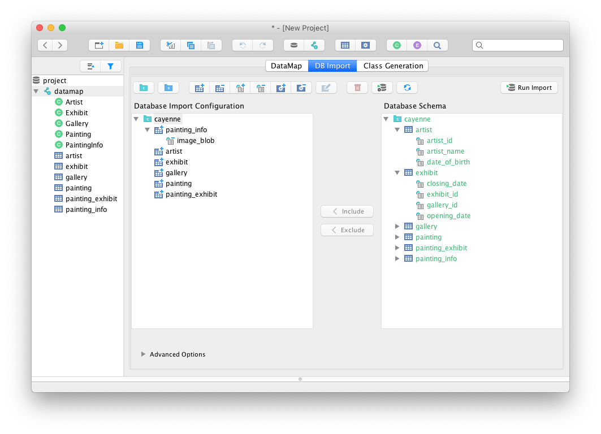

+++
title = "Cayenne 4.1 Final Released"
date = 2020-07-21 12:00:00+03:00
+++
<!--
  Licensed to the Apache Software Foundation (ASF) under one or more
  contributor license agreements. See the NOTICE file distributed with
  this work for additional information regarding copyright ownership.
  The ASF licenses this file to you under the Apache License, Version
  2.0 (the "License"); you may not use this file except in compliance
  with the License. You may obtain a copy of the License at
 
  https://www.apache.org/licenses/LICENSE-2.0 Unless required by
  applicable law or agreed to in writing, software distributed under the
  License is distributed on an AS IS BASIS, WITHOUT WARRANTIES OR
  CONDITIONS OF ANY KIND, either express or implied. See the License for
  the specific language governing permissions and limitations under the
  License.
-->


Apache Cayenne team is really glad to announce a final (general availability) release of _Cayenne 4.1_. 

Here is a recap of changes made since 4.0:

- New field-based data objects (see [CAY-2330](https://issues.apache.org/jira/browse/CAY-2330)), 
  that are **much faster** to read and write, while **significantly** reducing the app memory footprint.
  
- Dependency-free Cayenne core. No more velocity or commons-collections compile dependencies. Only "slf4j-api" is required in the base config.

- New extensible project XML structure. This allows to store cgen and reverse engineering configs along with the project.

- New reverse engineering UI in Cayenne Modeler, that is much more intuitive and customizable, 
more over configuration is now saved so you can evolve it with your model and perform reverse engineering in one click.
<p style="text-align: center;">
    
</p>

- User controlled transaction propagation logic and isolation level.

```java
    TransactionManager manager = runtime.getInjector().getInstance(TransactionManager.class);
    TransactionDescriptor descriptor = new TransactionDescriptor(
            Connection.TRANSACTION_SERIALIZABLE, // set transaction isolation to SERIALIZABLE 
            TransactionPropagation.REQUIRES_NEW  // require new transaction for every operation
    );
    manager.performInTransaction(() -> {
        // perform some DB operations...
        return null;
    }, descriptor);
    
```

- And numerous minor fixes and improvements. 

Cayenne can be downloaded from [here](/download/).

<div class="gap" style="margin-bottom: 3rem;"></div>

Here is bug fixes since the last release candidate:

* [CAY-2642](https://issues.apache.org/jira/browse/CAY-2642) EhCache memory leak due to misconfiguration
* [CAY-2643](https://issues.apache.org/jira/browse/CAY-2643) ObjectSelect.prefetch(name, semantics) method creates a phantom node
* [CAY-2646](https://issues.apache.org/jira/browse/CAY-2646) Wrong target path selection logic in cgen config
* [CAY-2647](https://issues.apache.org/jira/browse/CAY-2647) Modeler: project upgrade from 4.0.B2 to 4.1.RC2 failure
* [CAY-2653](https://issues.apache.org/jira/browse/CAY-2653) No methods for queries with qualifier parameters generated
* [CAY-2654](https://issues.apache.org/jira/browse/CAY-2654) Exception in dbimport when relationships should be imported, but no explicit configuration exists
